# 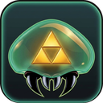 SMZ3 Universe

Super Metroid and A Link to the Past randomizer runs for the AYN Thor, the Nintendo 3DS and PC (Linux, Windows,
macOS). The game plays on one screen and the tracker sits on the other: map, items, checks, time and hints, read live
from the game.

Seeds are made on the device itself from your two ROMs, offline. The generator is a C port of
[SMZ3Randomizer](https://github.com/TheTrackerCouncil/SMZ3Randomizer), checked seed by seed against the original.

**Download: [latest release](https://github.com/doctor-utsugi/smz3-universe/releases/latest)**

| AYN Thor: Super Metroid | AYN Thor: A Link to the Past | AYN Thor: runs |
|---|---|---|
| 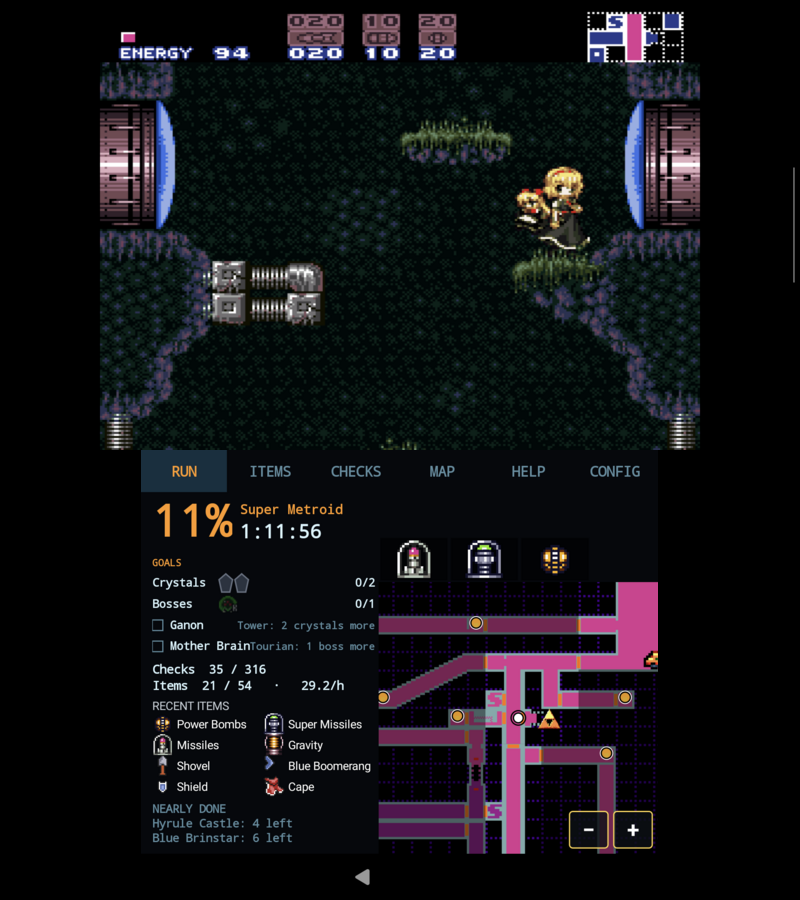 | 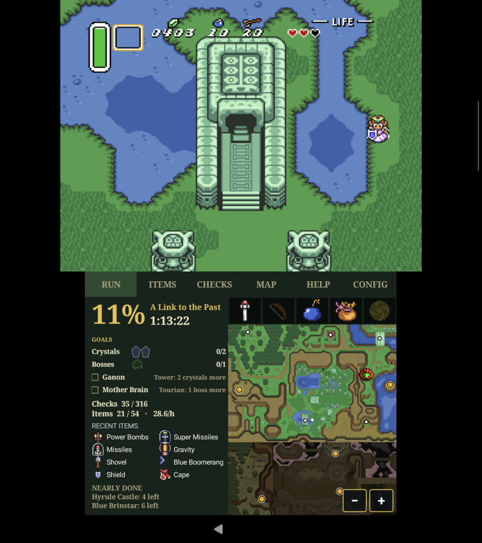 | 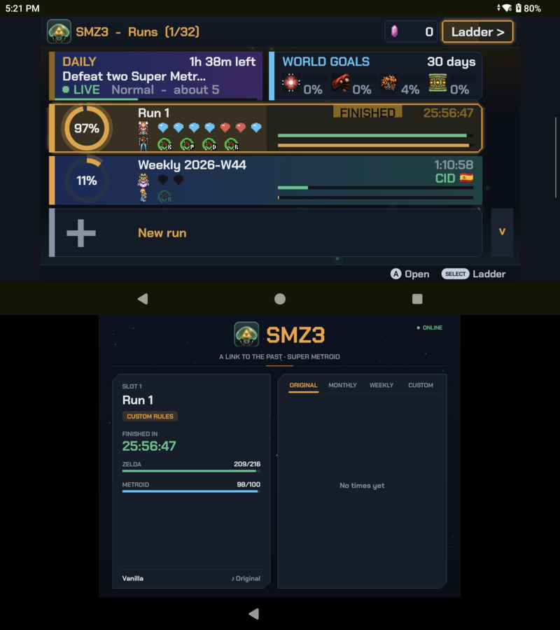 |

| 3DS | PC |
|---|---|
| 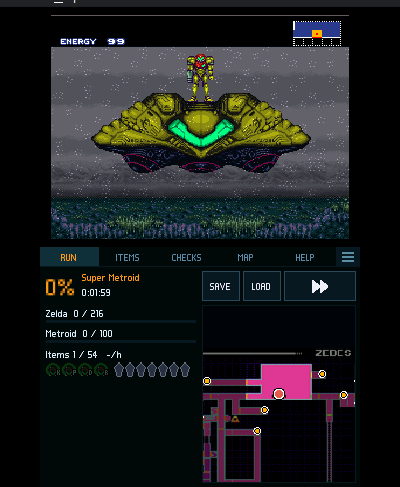 | 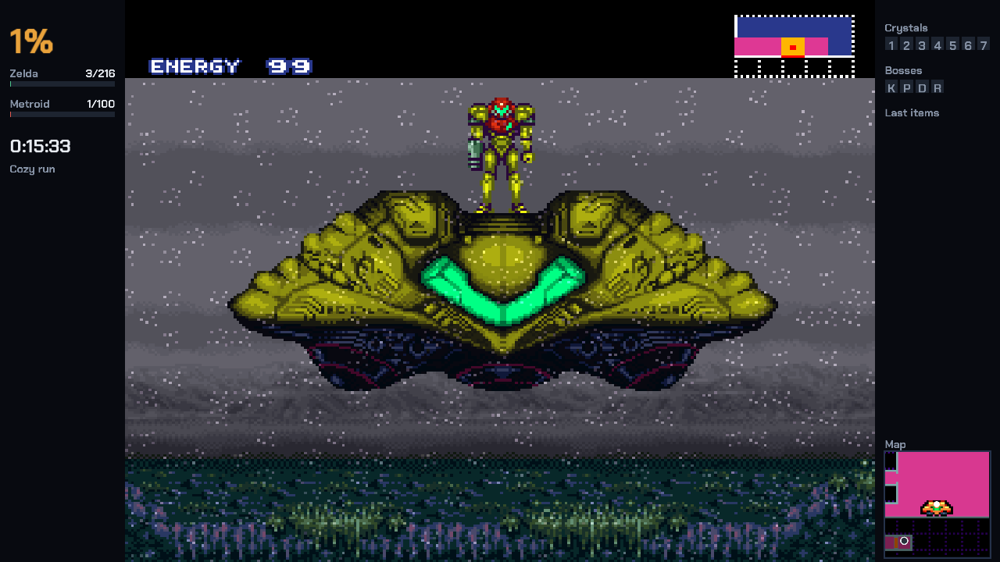 |
| 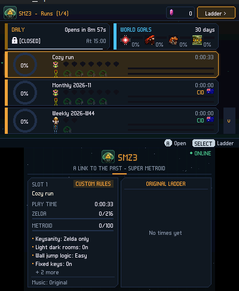 | 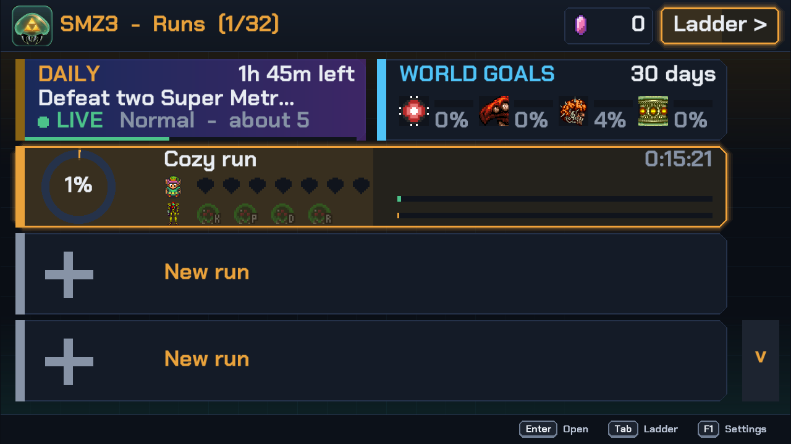 |

## Features

| | |
|---|---|
| 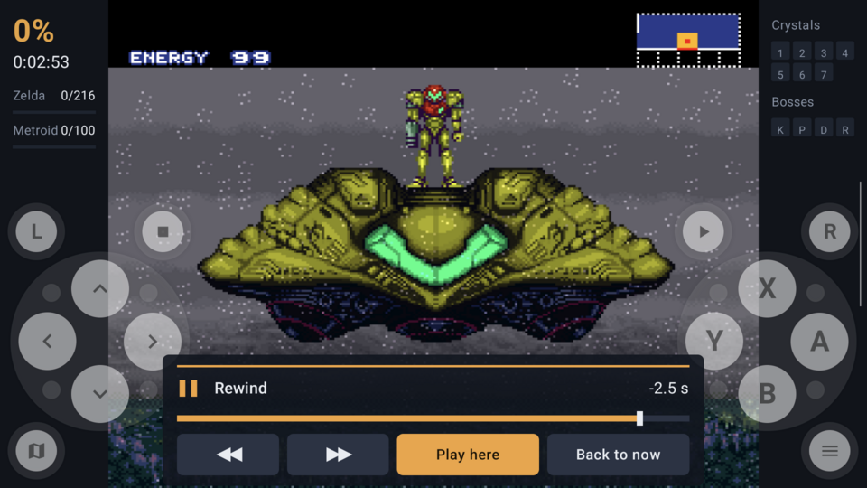 | **Rewind.** Hold a button and the game goes back, up to a minute on the Thor and PC. Let go to stop on a frame, then play on from there or go back to the present. The Cozy preset has it on. Ladder and daily runs never rewind. |
| 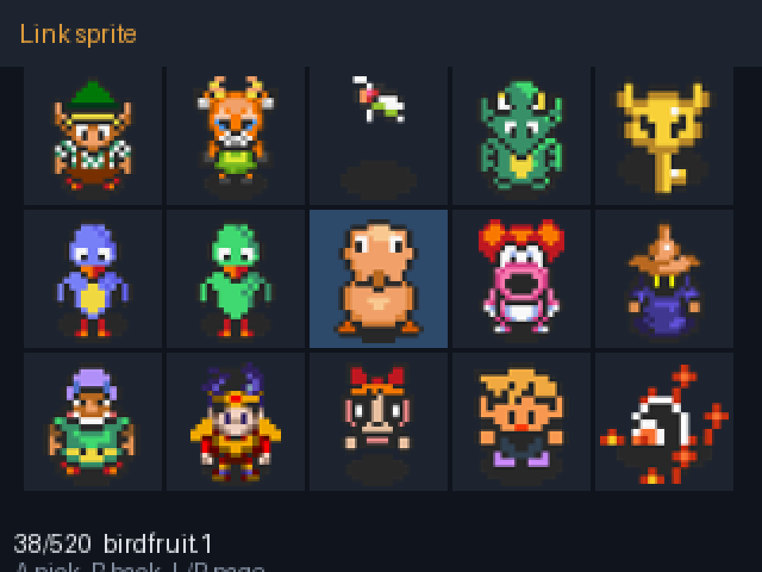 | **Character sprites.** Link has 517 community sprites to choose from and Samus has 107, besides the originals. Pick one per run, or let the run pick one at random. |
| 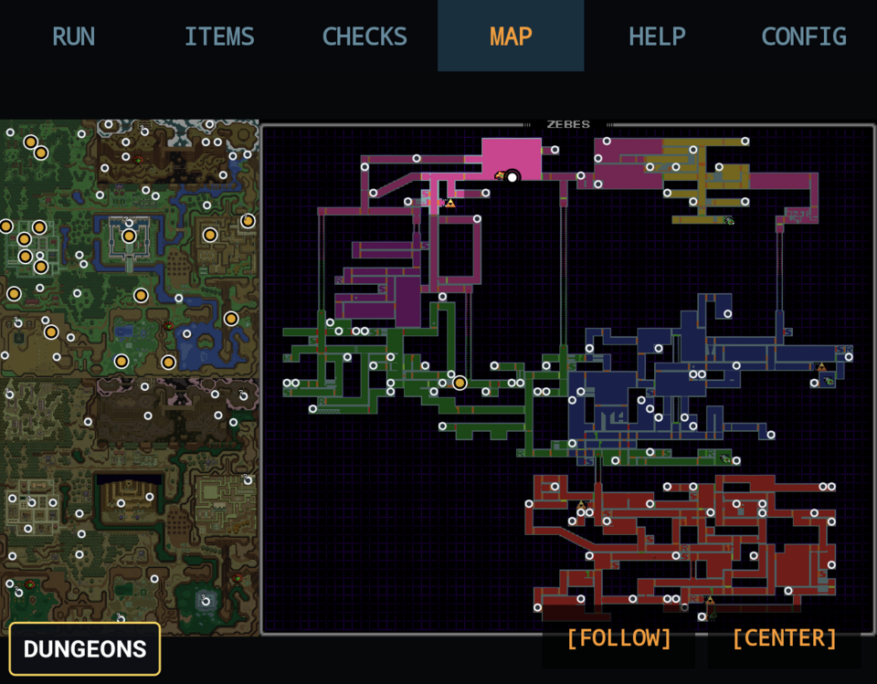 | **Map.** Both worlds on one map, with the checks you can reach in logic marked. It can follow you as you play, and the Dungeons button opens the dungeon maps. |
| 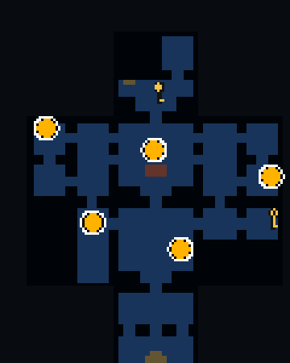 | **Dungeon maps.** Inside a Zelda dungeon you get the game's own map of it, read from your ROM, with the keys under pots and on enemies marked until you take them. |
| 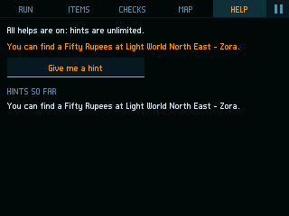 | **Hints.** All of them, none, or a few you spend when you're stuck: where an item is, or how many checks are left in a region. |
| 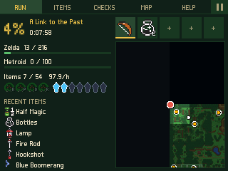 | **Shortcuts.** On the Thor and the 3DS, tap a row over the map to equip a Zelda item, switch a beam, or pick missiles, supers or power bombs. |
| 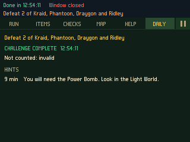 | **Daily challenge and ladders.** Three windows a day where everyone plays the same start with one goal. Original-rules, monthly and weekly runs go on the online ladder at [smz3.indieviral.com](https://smz3.indieviral.com). |

## Runs

The Thor and PC keep up to 32 runs and the 3DS keeps 4, plus the daily. Each run has its own save and play time, and
its row in the list shows the crystals and bosses you have so far.

- Cozy: keys shuffled in Zelda only, easy wall jumps, dark rooms lit, save states and rewind on. It stays on this
  device.
- Original: the default rules. A run with these rules can go on the online ladder.
- Custom: every option of the web generator, from item placement and keysanity to logic tweaks, starting items and
  plando. You can save a setup and pick it again later. Changed rules keep the run off the online ladder.
- Monthly seed: one fixed seed per month, the same for everyone, with its own table of best times.
- Weekly run: a short run on a new seed every Monday at 00:00 UTC. Two crystals open Ganon's Tower and Ganon, and
  one boss opens Tourian.
- Daily challenge: three windows a day of four hours each (06:00, 14:00 and 22:00 UTC). Everyone in a window gets
  the same start and one goal, such as "defeat two Super Metroid bosses". You get one attempt, timed in real time from
  when you press Start, with no fast forward and no save states. Hints come out on a schedule during the attempt,
  vague at first and exact later.

Online times go to [smz3.indieviral.com](https://smz3.indieviral.com), and each finish carries a proof of the checks
made along the way. The daily and the world goals pay rupeergies, a balance kept per install. Every month the
players also share a few world goals, like "defeat 30 Kraids": anyone who helped enough with a goal gets paid when
the month ends. Offline play works too; the run stays off the tables.

## The tracker

- A map of both worlds that marks the checks you can reach in logic. Inside a Zelda dungeon you also get the game's
  own map of it, read from your ROM.
- Items, checks by region, play time, and the regions you are closest to clearing.
- Hints, set when you create the run: all of them, none, or a few you spend when you want one (a hint, or the
  checks left in a region).
- On the Thor and the 3DS, shortcut rows over the map: tap to equip an ALttP item, turn a beam on or off, or pick
  missiles, super missiles or power bombs.
- On the 3DS, a save bar with quick save, quick load and fast forward. The 3D slider is fast forward too.


## 1. Get the two ROMs

You need your own dumps of these two games:

| Game | Version | MD5 |
|---|---|---|
| Super Metroid | Japan/USA "(JU)" | `21f3e98df4780ee1c667b84e57d88675` |
| A Link to the Past | Japan v1.0 (the USA and Europe ones don't work) | `03a63945398191337e896e5771f77173` |

`.sfc`, `.smc` or a `.zip`, with or without a header, all work. If a ROM is the wrong version, the app tells you which
one it needs. No ROMs are included here.

## 2. Install it

**AYN Thor / Android**
1. From the release, download `SMZ3-android-arm64.apk` on the Thor and open it. Allow installing from this source if asked.
2. Open SMZ3. It asks to show notifications; the game starts whether you allow them or not.
3. Create a run: tap "New run", pick Cozy run, Original or Custom, and press Start on the last screen. The game
   starts as soon as the seed is made.
4. The ROMs: the first time, SMZ3 looks for them in the `Download`, `Download/roms`, `Roms`, `roms` and `ROMs`
   folders of the device. If both are there as `.sfc` or `.smc` files, it uses them without asking. If not, a file
   picker opens: select both ROMs (or a zip with them). It keeps a copy of what you pick and won't ask again.

**3DS** (needs the Homebrew Launcher)
1. Copy `SMZ3-3ds.3dsx` from the release to the `3ds` folder of the SD card.
2. Copy both ROMs to `3ds/SMZ3` on the SD card (create the folder). `roms/snes` also works. If you used an
   older version, its `SMZ3` folder at the root of the card moves there by itself.
3. Open SMZ3 from the Homebrew Launcher and create a run.
4. No sound? Run the DSP1 homebrew once. It creates `3ds/dspfirm.cdc`, which every homebrew needs for sound.
5. Optional: for the community sprites, copy `assets/sprites` from this repo to `3ds/SMZ3/sprites` on the SD card.

**PC**
- Linux: download `SMZ3-x86_64.AppImage`, make it executable (`chmod +x SMZ3-x86_64.AppImage`, or tick
  "Allow executing" in its file properties) and run it. Nothing else to install.
- Linux on ARM (aarch64 handhelds and boards): the same with `SMZ3-aarch64.AppImage`. On a system without FUSE,
  which is common on handheld distributions, start it with `APPIMAGE_EXTRACT_AND_RUN=1 ./SMZ3-aarch64.AppImage`.
  It opens one window with the game and the tracker side by side. It hasn't been tried on a handheld yet.
- Windows: unzip `SMZ3-windows-x64.zip` and run `smz3.exe`. If SmartScreen warns, press "More info", then "Run anyway".
- macOS (Intel, also runs on Apple silicon): `tar xzf SMZ3-macos-intel.tar.gz`, then
  `xattr -d com.apple.quarantine smz3` and `./smz3`. Nothing else to install.

Then drop both ROMs on the window and press PLAY!. To make a run, pick "New run" in the list, choose Cozy run,
Original or Custom (Custom opens the options first, Next goes on), and press Start on the last screen. The game starts
as soon as the seed is made.

The same program also takes commands in a terminal. Use `./SMZ3-x86_64.AppImage` (or
`./SMZ3-aarch64.AppImage`) on Linux, `smz3.exe` on Windows and `./smz3` on macOS. For example, on Linux:

```
./SMZ3-x86_64.AppImage setup "Super Metroid (Japan, USA) (En,Ja).sfc" "Zelda no Densetsu - Kamigami no Triforce (Japan).sfc"
./SMZ3-x86_64.AppImage new --preset cozy
./SMZ3-x86_64.AppImage runs
./SMZ3-x86_64.AppImage play 1
```

`setup` keeps a copy of the two ROMs (you only do it once), `new` makes a run in the first free slot (`--preset`
is `cozy`, `original` or `custom`, and `--set Key=value` changes one option), `runs` lists them and `play N` opens
the window on run N. `gen --out FILE` writes a randomized ROM without making a run, and `--help` lists every command.

## 3. Play

The tracker's HELP tab lists the controls for your device.

## Building it yourself

`./build-pc.sh`, `./build-android.sh release` and `./build-3ds.sh` (needs Docker for devkitARM). `vendor/` is not in
git: the `n3ds`, `android` and `linux` jobs in [.github/workflows/pc.yml](.github/workflows/pc.yml) show what to clone
and prepare first.

The Android app is a fork of [Lemuroid](https://github.com/Swordfish90/Lemuroid) (GPL-3.0) on LibretroDroid, the 3DS
app is built on [snes9x_3ds](https://github.com/matbo87/snes9x_3ds).
