# 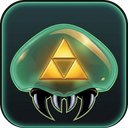 SMZ3 Universe

Super Metroid and A Link to the Past randomizer runs for the AYN Thor, the Nintendo 3DS and PC (Linux, Windows,
macOS). The game plays on one screen and the tracker sits on the other: map, items, checks, time and hints, read live
from the game.

Seeds are made on the device itself from your two ROMs, offline. The generator is a C port of
[SMZ3Randomizer](https://github.com/TheTrackerCouncil/SMZ3Randomizer), checked seed by seed against the original.

**Download: [latest release](https://github.com/doctor-utsugi/smz3-universe/releases/latest)**

[](https://youtu.be/PVDEDpWTlVg)

| AYN Thor: Super Metroid | AYN Thor: A Link to the Past | AYN Thor: runs |
|---|---|---|
| 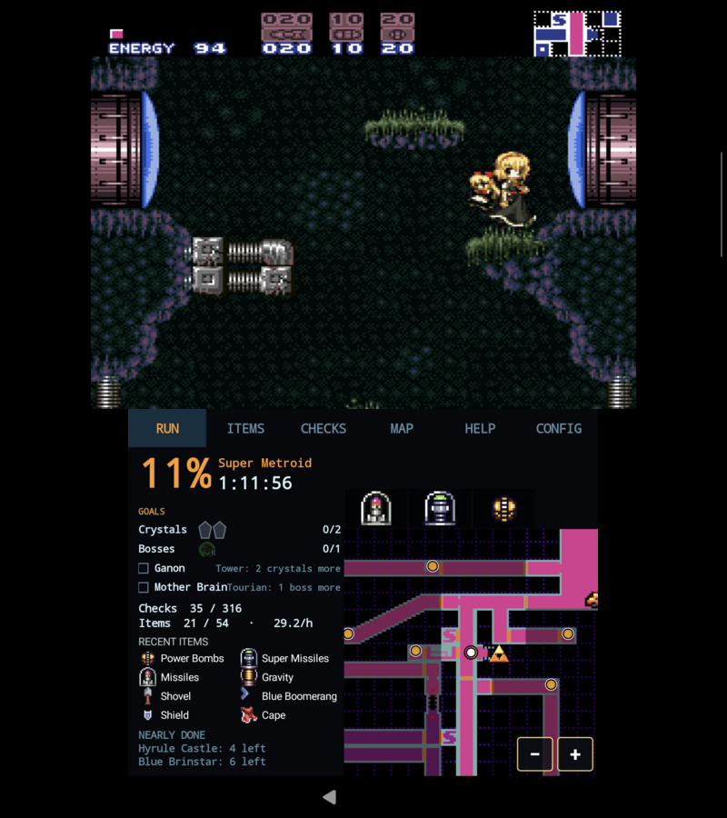 | 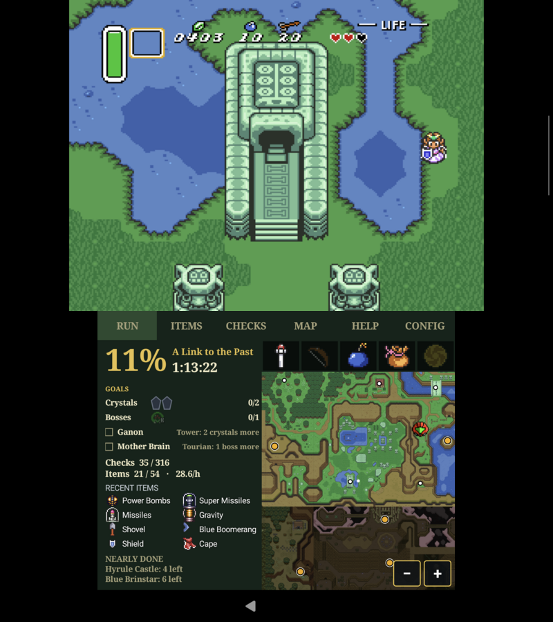 | 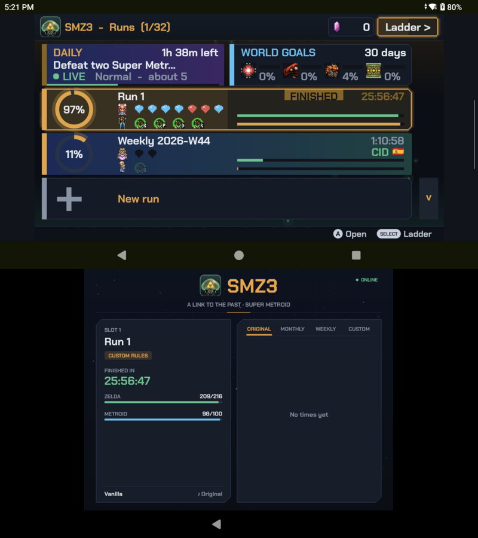 |

| 3DS | PC |
|---|---|
| 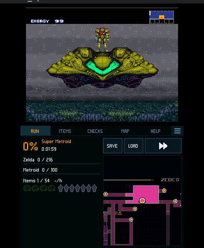 | 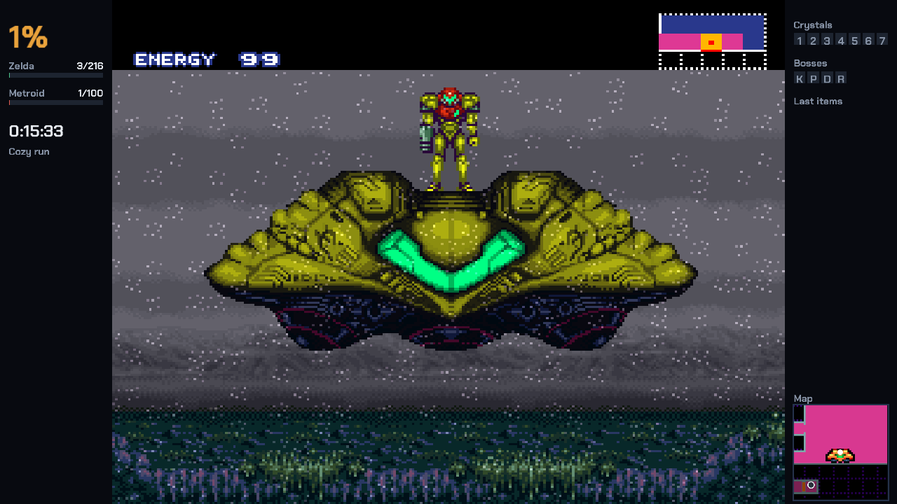 |
| 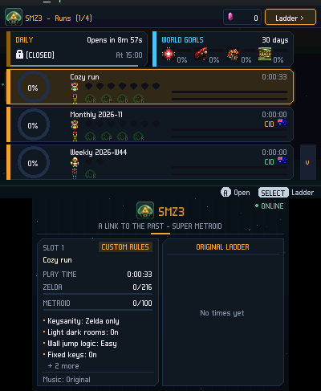 | 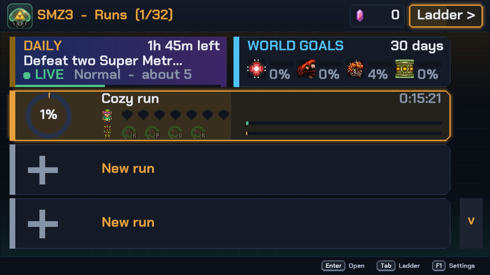 |

## Features

| | |
|---|---|
| 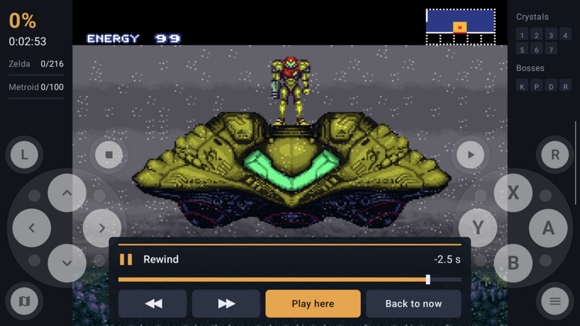 | **Rewind.** Hold a button and the game goes back, up to a minute on the Thor and PC. Let go to stop on a frame, then play on from there or go back to the present. The Cozy preset has it on. Ladder and daily runs never rewind. |
| 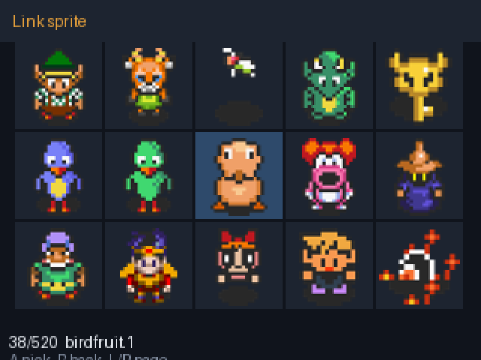 | **Character sprites.** Link has 517 community sprites to choose from and Samus has 107, besides the originals. Pick one per run, or let the run pick one at random. |
| 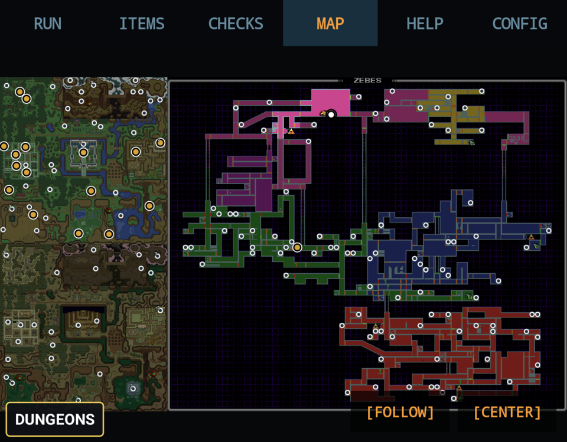 | **Map.** Both worlds on one map, with the checks you can reach in logic marked. It can follow you as you play, and the Dungeons button opens the dungeon maps. |
| 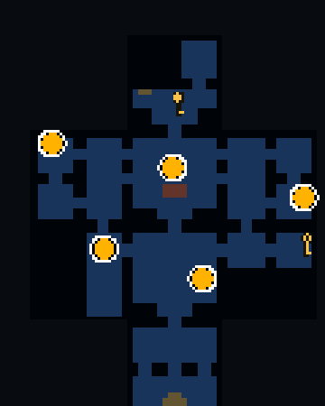 | **Dungeon maps.** Inside a Zelda dungeon you get the game's own map of it, read from your ROM, with the keys under pots and on enemies marked until you take them. |
| 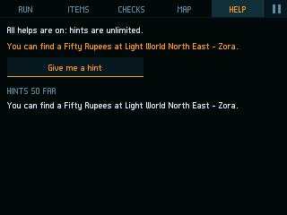 | **Hints.** All of them, none, or a few you spend when you're stuck: where an item is, or how many checks are left in a region. |
| 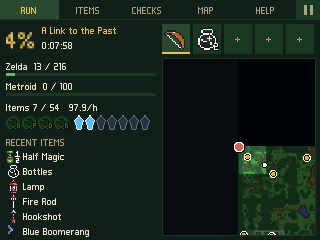 | **Shortcuts.** On the Thor and the 3DS, tap a row over the map to equip a Zelda item, switch a beam, or pick missiles, supers or power bombs. |
| 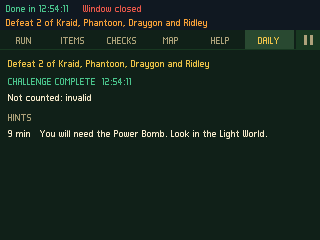 | **Daily challenge and ladders.** Three windows a day where everyone plays the same start with one goal. Original-rules, monthly and weekly runs go on the online ladder at [smz3.com/ladder](https://smz3.com/ladder). |

## Runs

The Thor and PC keep up to 32 runs and the 3DS keeps 4, plus the daily. Each run has its own save and play time, and
its row in the list shows the crystals and bosses you have so far.

- Cozy: keys shuffled in Zelda only, easy wall jumps, dark rooms lit, save states and rewind on. It stays on this
  device.
- Original: the default rules. A run with these rules can go on the online ladder.
- Custom: every option of the web generator, from item placement and keysanity to logic tweaks, starting items and
  plando. You can save a setup and pick it again later. Changed rules keep the run off the online ladder.
- Map Rando (Super Metroid runs): [Map Rando](https://maprando.com) rebuilds the whole map, as SM races play it.
  Pick Beginner, Season 5 or another preset and a skill level. A device with 768 MB of RAM and 400 MB of it free
  (PCs, the Thor, phones, a 1 GB handheld) makes the seed itself, in a few seconds; a New 3DS running the CIA does too,
  in one to three minutes. Smaller devices, an Old 3DS and the 3DS's Homebrew Launcher version download it from the
  server and say so. Options > Map Rando seeds changes that: automatic, built here, or from the server. Offline, a run with a preset and the preset's own skill plays one of the 32 seeds the game comes with (8 per
  preset); races, the weekly and the monthly never do, so everyone there plays the same map. The tracker shows items
  and the hash only, since its map is the vanilla one. A Season 5 or Beginner run with the preset's own settings
  goes on that preset's online table.
- Race presets (A Link to the Past runs): Casual Boots, Standard and AD Keys, as SahasrahBot defines them for
  racetime races. Each has its own online table; on the ladder screen, A on the first tab switches tables.
- Monthly seed: one fixed seed per month, the same for everyone, with its own table of best times.
- Weekly run: a short run on a new seed every Monday at 00:00 UTC. Two crystals open Ganon's Tower and Ganon, and
  one boss opens Tourian.
- Daily challenge: three windows a day of four hours each (06:00, 14:00 and 22:00 UTC). Everyone in a window gets
  the same start and one goal, such as "defeat two Super Metroid bosses". You get one attempt, timed in real time from
  when you press Start, with no fast forward and no save states. Hints come out on a schedule during the attempt,
  vague at first and exact later.

Online times go to [smz3.com/ladder](https://smz3.com/ladder), and each finish carries a proof of the checks
made along the way. The daily and the world goals pay rupeergies, a balance kept per install. Every month the
players also share a few world goals, like "defeat 30 Kraids": anyone who helped enough with a goal gets paid when
the month ends. Offline play works too; the run stays off the tables.

## The tracker

- A map of both worlds that marks the checks you can reach in logic. Inside a Zelda dungeon you also get the game's
  own map of it, read from your ROM.
- Items, checks by region, play time, and the regions you are closest to clearing.
- Hints, set when you create the run: all of them, none, or a few you spend when you want one (a hint, or the
  checks left in a region).
- On the Thor and the 3DS, shortcut rows over the map: tap to equip an ALttP item, turn a beam on or off, or pick
  missiles, super missiles or power bombs.
- On the 3DS, a save bar with quick save, quick load and fast forward. The 3D slider is fast forward too.


## 1. Get the two ROMs

You need your own dumps of these two games:

| Game | Version | MD5 |
|---|---|---|
| Super Metroid | Japan/USA "(JU)" | `21f3e98df4780ee1c667b84e57d88675` |
| A Link to the Past | Japan v1.0 (the USA and Europe ones don't work) | `03a63945398191337e896e5771f77173` |

`.sfc`, `.smc` or a `.zip`, with or without a header, all work. If a ROM is the wrong version, the app tells you which
one it needs. No ROMs are included here.

## 2. Install it

Pick your platform. Every file is in the [latest release](https://github.com/doctor-utsugi/smz3-universe/releases/latest).

| Platform | File | Steps |
|---|---|---|
| AYN Thor, Android phones | `SMZ3-android-arm64.apk` | [Thor and Android](#ayn-thor-and-android) |
| 3DS, on the HOME menu | `SMZ3-3ds.cia` (install with FBI) | [Nintendo 3DS](#nintendo-3ds) |
| 3DS, from the Homebrew Launcher | `SMZ3-3ds.3dsx` | [Nintendo 3DS](#nintendo-3ds) |
| ROCKNIX, Knulli | `SMZ3-ports-aarch64.zip` | [Linux handhelds](#linux-handhelds-with-a-ports-menu) |
| Linux PC | `SMZ3-x86_64.AppImage` | [PC](#pc-linux-windows-macos) |
| Linux on ARM boards | `SMZ3-aarch64.AppImage` | [PC](#pc-linux-windows-macos) |
| Windows | `SMZ3-windows-x64.zip` | [PC](#pc-linux-windows-macos) |
| macOS | `SMZ3-macos-intel.tar.gz` | [PC](#pc-linux-windows-macos) |

How updates work on each is under [Updates](#updates).

### AYN Thor and Android

arm64.

1. Put both ROMs in the `Download` folder of the device. You can copy them over USB from a computer, or download
   them on the device itself. `Download/roms`, `Roms`, `roms` and `ROMs` work too.
2. On the device, open the [latest release](https://github.com/doctor-utsugi/smz3-universe/releases/latest) in the
   browser and tap `SMZ3-android-arm64.apk` under Assets to download it.
3. Open the downloaded file: tap Open when the download finishes, or find it in the browser's Downloads.
4. If Android says it can't install unknown apps from this source, tap Settings, turn on "Allow from this source",
   go back and tap Install. When it's installed, tap Open.
5. SMZ3 asks to show notifications. The game starts whether you allow them or not.
6. Tap "New run", pick Cozy run, Original or Custom, and press Start on the last screen. The first time, SMZ3
   reads the two ROMs from the folder of step 1. The game starts as soon as the seed is made.

If the ROMs aren't in one of those folders, or they're in a zip, a file picker opens at step 6 instead: select both
ROMs (or the zip). SMZ3 keeps a copy of what you pick and won't ask again.

---

### Nintendo 3DS

Needs custom firmware with the Homebrew Launcher, or FBI for the CIA.

There are two ways to install it, both from the [latest release](https://github.com/doctor-utsugi/smz3-universe/releases/latest).
Pick one; runs and settings are the same files on the SD card either way.

- **CIA, with an icon on the HOME menu:** copy `SMZ3-3ds.cia` to the SD card (the `cias` folder, for example). On the
  3DS, open FBI, go to SD, select the file and choose "Install CIA". SMZ3 then shows up on the HOME menu, and you
  can delete the `.cia` from the card.
- **Homebrew Launcher:** copy `SMZ3-3ds.3dsx` to the `3ds` folder of the SD card. SMZ3 shows up in the Homebrew
  Launcher, not on the HOME menu.

Then:
1. Copy both ROMs to `3ds/SMZ3` on the SD card (create the folder). `roms/snes` also works. If you used an
   older version, its `SMZ3` folder at the root of the card moves there by itself.
2. Open SMZ3 (from the HOME menu or the Homebrew Launcher) and create a run.
3. No sound? Run the DSP1 homebrew once. It creates `3ds/dspfirm.cdc`, which every homebrew needs for sound.

The community sprites come with the app. A sprite of your own (an `.rdc` file) goes in `3ds/SMZ3/sprites/link` or
`3ds/SMZ3/sprites/samus` on the SD card, and one there with the same name as a bundled sprite replaces it.

---

### Linux handhelds with a Ports menu

ROCKNIX or Knulli, arm64. Tested on an Anbernic RG DS with ROCKNIX, where the tracker opens on the second screen, and on
an Anbernic RG 40XXV with Knulli (one 640 x 480 screen), where the tracker opens over the game.

1. On a computer, download `SMZ3-ports-aarch64.zip` from the [latest release](https://github.com/doctor-utsugi/smz3-universe/releases/latest)
   and unzip it. You get a file, `SMZ3.sh`, and a folder, `SMZ3`.
2. Connect the handheld to the computer by USB (it shows up as a device with a `Roms` folder) or put its games card in
   the computer. Copy `SMZ3.sh` and the `SMZ3` folder into the `ports` folder.
3. Copy both ROMs into that `ports/SMZ3` folder, loose or in a zip.
4. On the handheld, press Start and choose Game settings, then Update gamelists.
5. Open Ports and start SMZ3. The first time, it reads the two ROMs from the folder of step 3.
6. Choose "New run", pick Cozy run, Original or Custom, and press Start on the last screen. The game starts as soon as
   the seed is made.

To go back to the handheld's menu, press Select + Start in the game and then A, or tap "Save and leave the run" twice at
the top of the tracker's CONFIG tab. Then choose Quit in the game's menu (Start / Load game, Online draft, ...).

On a handheld with one screen (the RG 40XXV):

- The buttons follow the letters printed on the console, whatever mapping the system hands to games.
- With no R3, L3 opens the tracker and the menu button leaves the run. On the MAP tab only the D-pad moves the map.
- The tracker's CONFIG tab has the settings (save slot, fast-forward speed, screen, the corner info and the daily
  challenge) and the button setup. The corner shows the % and the time, as the side panels don't fit.
- Map Rando seeds are made on the handheld, in 10 to 70 seconds.

---

### PC (Linux, Windows, macOS)

- **Linux:** download `SMZ3-x86_64.AppImage`, make it executable (`chmod +x SMZ3-x86_64.AppImage`, or tick
  "Allow executing" in its file properties) and run it. Nothing else to install.
- **Linux on ARM** (aarch64 boards): the same with `SMZ3-aarch64.AppImage`. On a system without FUSE,
  start it with `APPIMAGE_EXTRACT_AND_RUN=1 ./SMZ3-aarch64.AppImage`. For a handheld with a Ports menu, use the
  [Linux handhelds](#linux-handhelds-with-a-ports-menu) steps instead.
- **Windows:** unzip `SMZ3-windows-x64.zip` and run `smz3.exe`. If SmartScreen warns, press "More info", then "Run anyway".
- **macOS** (Intel, also runs on Apple silicon): `tar xzf SMZ3-macos-intel.tar.gz`, then
  `xattr -d com.apple.quarantine smz3` and `./smz3`. Nothing else to install.

Then drop both ROMs on the window and press PLAY!. To make a run, pick "New run" in the list, choose Cozy run,
Original or Custom (Custom opens the options first, Next goes on), and press Start on the last screen. The game starts
as soon as the seed is made.

The same program also takes commands in a terminal. Use `./SMZ3-x86_64.AppImage` (or
`./SMZ3-aarch64.AppImage`) on Linux, `smz3.exe` on Windows and `./smz3` on macOS. For example, on Linux:

```
./SMZ3-x86_64.AppImage setup "Super Metroid (Japan, USA) (En,Ja).sfc" "Zelda no Densetsu - Kamigami no Triforce (Japan).sfc"
./SMZ3-x86_64.AppImage new --preset cozy
./SMZ3-x86_64.AppImage runs
./SMZ3-x86_64.AppImage play 1
```

`setup` keeps a copy of the two ROMs (you only do it once), `new` makes a run in the first free slot (`--preset`
is `cozy`, `original` or `custom`, and `--set Key=value` changes one option), `runs` lists them and `play N` opens
the window on run N. `gen --out FILE` writes a randomized ROM without making a run, and `--help` lists every command.

---

### Updates

When a new release is out, the start menu says so and Options gets an Update row. On Android it
downloads the new APK and opens the installer. The Linux AppImage (also in Ports), the Windows exe and the macOS
binary replace themselves and restart. On the 3DS it only tells you: install the new `.cia` with FBI over the old one, or copy
the new `.3dsx` over the old one. Your runs and settings stay as they are.

## 3. Play

The tracker's HELP tab lists the controls for your device.

## Building it yourself

`./build-pc.sh`, `./build-android.sh release` and `./build-3ds.sh` (needs Docker for devkitARM). `vendor/` is not in
git: the `n3ds`, `android` and `linux` jobs in [.github/workflows/pc.yml](.github/workflows/pc.yml) show what to clone
and prepare first.

The Android app is a fork of [Lemuroid](https://github.com/Swordfish90/Lemuroid) (GPL-3.0) on LibretroDroid, the 3DS
app is built on [snes9x_3ds](https://github.com/matbo87/snes9x_3ds).

## Credits

SMZ3 and Super Metroid generators: tewtal (MIT). A Link to the Past: sporchia and alttpr (MIT), z3randomizer by
KatDevsGames (MIT), Enemizer by Zarby89 (MIT). Map Rando: maddo and kyleb (MIT). Map Rando's logic data is
[sm-json-data](https://github.com/vg-json-data/sm-json-data), developed by the A Link to the Past Randomizer & Super
Metroid Randomizer communities, under [CC BY 4.0](https://creativecommons.org/licenses/by/4.0/). Emulation by Snes9x,
snes9x_3ds, Lemuroid and LibretroDroid. Dan ([danisreallycool](https://github.com/danisreallycool)) made the first
web version and Map Rando's fix for 32-bit hosts. [THIRD_PARTY.md](THIRD_PARTY.md) has the notices.
